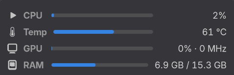

# System Monitor Panel for GNOME

A GNOME Shell extension that shows CPU, temperature, GPU and RAM usage in the top bar, with a list of the heaviest apps and a button to close them.




Requires GNOME Shell 50.

## Install

```bash
git clone https://github.com/voidrlm/gnome-system-monitor-panel.git ~/.local/share/gnome-shell/extensions/system-monitor-panel@arjun
```

Log out and back in, then enable it:

```bash
gnome-extensions enable system-monitor-panel@arjun
```

## Update

```bash
git -C ~/.local/share/gnome-shell/extensions/system-monitor-panel@arjun pull
```

Then log out and back in.
